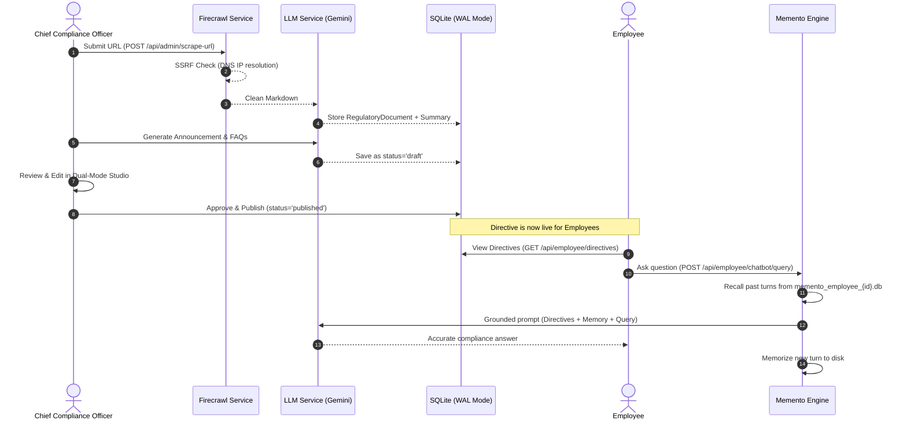

# ReguComply AI: Project Technical Manual & Architecture Reference

> **Document Version:** 1.0.0  
> **Target Audience:** Software Engineers, System Architects, Compliance Tech Leads  
> **Scope:** Core Class Structures, Database Models, Service Classes, API Contracts, and Frontend Component Hierarchy.

---

## 📑 Table of Contents
1. [System Overview & Domain Model](#1-system-overview--domain-model)
2. [Database Models & Entity Architecture (`models.py`)](#2-database-models--entity-architecture-modelspy)
3. [Request & Response Schemas (`schemas.py`)](#3-request--response-schemas-schemaspy)
4. [Backend Services & Core Classes (`services/`)](#4-backend-services--core-classes-services)
   - [4.1 `FirecrawlService`](#41-firecrawlservice)
   - [4.2 `LLMService`](#42-llmservice)
   - [4.3 `MementoService`](#43-mementoservice)
5. [Security & Role-Based Access Control (`security.py`)](#5-security--role-based-access-control-securitypy)
6. [API Route Controllers (`routes/`)](#6-api-route-controllers-routes)
7. [Frontend Architecture & Component Reference](#7-frontend-architecture--component-reference)
8. [Entity Relationship & Data Flow Reference](#8-entity-relationship--data-flow-reference)

---

## 1. System Overview & Domain Model

**ReguComply AI** is an enterprise-grade regulatory compliance communication platform. Its primary function is to transform raw, dense legal circulars (from government agencies like RBI, SEBI, and SEC) into structured executive summaries, departmental obligations, and actionable employee FAQs, while providing employees with a grounded AI assistant backed by isolated persistent memory.

### Core Domain Entities
```
┌──────────────┐       1:N       ┌──────────────────────┐
│     User     │ ─────────────── │     Announcement     │
│ (Admin/Empl) │                 │ (Draft/Published)    │
└──────┬───────┘                 └──────────┬───────────┘
       │ 1:N                                │ 1:N
       ▼                                    ▼
┌──────────────────────┐         ┌──────────────────────┐
│ ConversationMetadata │         │         FAQ          │
│ (Chatbot Sessions)   │         │ (Departmental Q&As)  │
└──────────────────────┘         └──────────────────────┘
                                            │
                                            │ N:1
                                 ┌──────────▼───────────┐
                                 │  RegulatoryDocument  │
                                 │  (Scraped Raw Source)│
                                 └──────────────────────┘
```

---

## 2. Database Models & Entity Architecture (`models.py`)

All relational tables are managed via SQLAlchemy ORM and stored in SQLite (operating under Write-Ahead Logging `WAL` mode).

### 2.1 `User` Class
Represents authenticated corporate users (Administrators and Employees).

```python
class User(Base):
    __tablename__ = "users"
```

| Field Name | Type | Constraints | Description |
| :--- | :--- | :--- | :--- |
| `id` | `Integer` | Primary Key, Autoincrement | Unique internal user identifier |
| `name` | `String(120)` | Not Null | Full display name (e.g., "Alice Sharma (Operations)") |
| `email` | `String(255)` | Unique, Indexed, Not Null | Corporate email used for authentication |
| `hashed_password` | `String(255)` | Not Null | Bcrypt one-way password hash |
| `role` | `String(20)` | Not Null, Default: `"employee"` | Access tier: strictly `"admin"` or `"employee"` |
| `created_at` | `DateTime` | Not Null, Default: UTC Now | Account creation timestamp |

**Relationships:**
- `approved_announcements`: `1:N` relationship to `Announcement` (tracks which admin published an update).
- `conversations`: `1:N` relationship to `ConversationMetadata`.

---

### 2.2 `RegulatoryDocument` Class
Stores the raw, unedited regulatory circular fetched from external government websites.

```python
class RegulatoryDocument(Base):
    __tablename__ = "regulatory_documents"
```

| Field Name | Type | Constraints | Description |
| :--- | :--- | :--- | :--- |
| `id` | `Integer` | Primary Key, Autoincrement | Unique document identifier |
| `title` | `String(255)` | Not Null | Document title extracted from the source |
| `source_url` | `String(1024)`| Indexed, Not Null | Official external URL (e.g. `https://rbi.org.in/...`) |
| `extracted_content`| `Text` | Not Null | Clean Markdown extracted via Firecrawl |
| `summary` | `Text` | Nullable | LLM-generated structured JSON analysis |
| `metadata_json` | `Text` | Nullable | Raw scraper metadata (OG tags, headers, status) |
| `created_at` | `DateTime` | Not Null, Default: UTC Now | Ingestion timestamp |

**Relationships:**
- `announcements`: `1:N` relationship to `Announcement` with `cascade="all, delete-orphan"`.

---

### 2.3 `Announcement` Class
Represents the human-reviewed compliance directive broadcasted to the company.

```python
class Announcement(Base):
    __tablename__ = "announcements"
```

| Field Name | Type | Constraints | Description |
| :--- | :--- | :--- | :--- |
| `id` | `Integer` | Primary Key, Autoincrement | Unique announcement identifier |
| `document_id` | `Integer` | Foreign Key (`regulatory_documents.id`) | Reference to parent source circular |
| `title` | `String(255)` | Not Null | Executive directive headline |
| `content` | `Text` | Not Null | Full Markdown directive text |
| `status` | `String(20)` | Not Null, Default: `"draft"` | Lifecycle: `"draft"`, `"pending"`, or `"published"` |
| `created_at` | `DateTime` | Not Null, Default: UTC Now | Draft creation timestamp |
| `published_at` | `DateTime` | Nullable | Exact timestamp when approved by admin |
| `approved_by` | `Integer` | Foreign Key (`users.id`), Nullable | Admin ID who authorized the release |

**Relationships:**
- `document`: `N:1` reference back to `RegulatoryDocument`.
- `approver`: `N:1` reference back to `User`.
- `faqs`: `1:N` relationship to `FAQ` with `cascade="all, delete-orphan"`.

---

### 2.4 `FAQ` Class
Pre-generated departmental questions and answers associated with a published announcement.

```python
class FAQ(Base):
    __tablename__ = "faqs"
```

| Field Name | Type | Constraints | Description |
| :--- | :--- | :--- | :--- |
| `id` | `Integer` | Primary Key, Autoincrement | Unique FAQ identifier |
| `announcement_id`| `Integer` | Foreign Key (`announcements.id`) | Reference to parent announcement |
| `question` | `String(500)` | Not Null | Specific operational compliance question |
| `answer` | `Text` | Not Null | Actionable, grounded answer |
| `category` | `String(100)` | Nullable, Default: `"General"` | Department tag (`IT`, `Operations`, `Audit`) |
| `created_at` | `DateTime` | Not Null, Default: UTC Now | Generation timestamp |

---

### 2.5 `ConversationMetadata` Class
Tracks session health and high-level interaction history for each employee.

```python
class ConversationMetadata(Base):
    __tablename__ = "conversation_metadata"
```

| Field Name | Type | Constraints | Description |
| :--- | :--- | :--- | :--- |
| `id` | `Integer` | Primary Key, Autoincrement | Unique conversation identifier |
| `employee_id` | `Integer` | Foreign Key (`users.id`), Not Null | Reference to owning employee |
| `session_id` | `String(100)` | Indexed, Not Null | Unique session UUID |
| `turn_count` | `Integer` | Default: `0` | Number of question/answer turns completed |
| `summary` | `Text` | Nullable | Periodic rolling summary of the conversation |
| `created_at` | `DateTime` | Default: UTC Now | First query timestamp |
| `last_active_at` | `DateTime` | Default: UTC Now | Most recent message timestamp |

---

## 3. Request & Response Schemas (`schemas.py`)

FastAPI uses Pydantic models to enforce strict schema validation on all inputs and outputs.

### Authentication Schemas
- **`UserLoginRequest`**: Validates incoming credentials (`email: EmailStr`, `password: str`).
- **`UserResponse`**: Safe user representation returned to clients (`id`, `name`, `email`, `role`, `created_at`) — strictly excludes `hashed_password`.
- **`TokenResponse`**: Returns JWT access bearer tokens (`access_token: str`, `token_type: str`, `user: UserResponse`).

### Regulatory Ingestion Schemas
- **`ScrapeUrlRequest`**: Validates target URLs (`url: HttpUrl`).
- **`ScrapeResultResponse`**: Returns `{ document: RegulatoryDocumentResponse, analysis: dict }`.

### Directive & Publishing Schemas
- **`AnnouncementUpdateRequest`**: Validates admin edits (`title: Optional[str]`, `content: Optional[str]`, `status: Optional[str]`, `faqs: Optional[List[FAQCreate]]`).
- **`AnnouncementResponse`**: Full payload including nested FAQs, approver details, and publication timestamps.

### Chatbot Schemas
- **`ChatbotQueryRequest`**: Accepts employee questions (`query: str`, `session_id: Optional[str]`).
- **`ChatbotQueryResponse`**: Returns the synthesized answer, reference sources, and memory retrieval metadata (`query`, `answer`, `recalled_turns`, `sources`).

---

## 4. Backend Services & Core Classes (`services/`)

The business logic is encapsulated in three singleton service classes:

```
app/services/
├── firecrawl_service.py  ──> Scrapes web pages into Markdown & enforces SSRF rules
├── llm_service.py        ──> Orchestrates Gemini 2.5 Flash for summarization & RAG
└── memento_service.py    ──> Manages per-employee bitemporal memory graphs
```

---

### 4.1 `FirecrawlService`
**File:** [firecrawl_service.py](file:///c:/Users/B%20NAVANEETH/Compliance-Communication-System/backend/app/services/firecrawl_service.py)  
**Primary Responsibility:** Handles external regulatory website scraping and network security validation.

#### Key Methods & Attributes:
- **`active_api_key -> str` (Property):** Reads `FIRECRAWL_API_KEY` dynamically from environment or fallback settings.
- **`validate_url_security(url: str) -> None`:**  
  Protects against **Server-Side Request Forgery (SSRF)**. Parses the hostname, resolves its IP addresses via `socket.getaddrinfo()`, and rejects any address resolving to:
  - Loopback (`127.0.0.1`, `::1`)
  - Private networks (RFC 1918: `10.0.0.0/8`, `172.16.0.0/12`, `192.168.0.0/16`)
  - Link-local and cloud metadata (`169.254.169.254`)
- **`scrape_url(url: str) -> Dict[str, Any]`:**  
  Executes the scrape. Tries the official `FirecrawlApp` SDK first. If unavailable, falls back to direct REST calls via `httpx.Client` with automated SSL fallback for environments with local antivirus interception (e.g. Avast/Zscaler). Returns clean Markdown with preserved tables.

---

### 4.2 `LLMService`
**File:** [llm_service.py](file:///c:/Users/B%20NAVANEETH/Compliance-Communication-System/backend/app/services/llm_service.py)  
**Primary Responsibility:** AI text processing, legal entity extraction, and grounded compliance answers.

#### Key Methods:
- **`analyze_regulatory_text(content: str, source_url: str) -> Dict[str, Any]`:**  
  Prompts Gemini 2.5 Flash with a strict schema to extract:
  - `issuing_authority` (e.g. "Reserve Bank of India")
  - `effective_date` and `compliance_deadlines`
  - `impacted_departments` (`IT`, `Credit/Loans`, `Risk`, `Operations`)
  - `mandatory_obligations` (ordered checklist)
  - `penalty_clauses` (statutory fines and consequences)
- **`generate_announcement(document_title: str, analysis_summary: dict) -> Dict[str, str]`:**  
  Transforms dense statutory obligations into a scannable, plain-language executive directive with headers, callout boxes, and action items.
- **`generate_faqs(announcement_title: str, announcement_content: str, count: int = 4) -> List[Dict[str, str]]`:**  
  Anticipates practical operational questions frontline employees will ask and generates practical Q&A pairs.
- **`answer_employee_query(query: str, published_directives: list, memory_context: str, employee_name: str) -> str`:**  
  Synthesizes a compliance response strictly grounded in the company's approved directives and the employee's past conversation context.

---

### 4.3 `MementoService`
**File:** [memento_service.py](file:///c:/Users/B%20NAVANEETH/Compliance-Communication-System/backend/app/services/memento_service.py)  
**Primary Responsibility:** Bitemporal conversational memory and strict physical tenant isolation.

#### Architecture & Thread Safety:
- **`self._meta_lock` (`threading.Lock`):** Protects dictionary updates for per-employee locks.
- **`self._employee_locks` (`Dict[int, threading.Lock]`):** Allocates a dedicated lock for each employee ID, ensuring Alice and Bob run concurrently without blocking each other while preventing multiple requests from the same user from colliding on disk.
- **`_get_employee_memento(employee_id: int)`:** Dynamically opens the dedicated SQLite database for that specific employee:
  ```
  backend/data/memento/memento_employee_{id}.db
  ```

#### Key Methods:
- **`recall(employee_id: int, query: str, limit: int = 5) -> str`:**  
  Searches the employee's personal knowledge graph and verbatim chunks for relevant historical context. Returns formatted markdown of past related discussions.
- **`memorize(employee_id: int, query: str, response: str) -> None`:**  
  Vectorizes and embeds the interaction, updating both the verbatim transcript and the episodic knowledge graph in `memento_employee_{id}.db`.
- **`get_conversation_history(employee_id: int, limit: int = 50) -> List[Dict]`:**  
  Inspects SQLite schema dynamically and fetches past turns ordered by timestamp.

---

## 5. Security & Role-Based Access Control (`security.py`)

Authentication is powered by **JSON Web Tokens (JWT)** and **Bcrypt**:

```
[ Incoming HTTP Request ]
            │
            ▼
[ HTTPBearer Authorization Header ]
            │
            ▼
[ jwt.decode(token, SECRET_KEY, algorithms=["HS256"]) ]
            │
            ▼
[ Extract user_id & role from payload ]
            │
     ┌──────┴──────┐
     ▼             ▼
[ require_admin ]  [ require_employee_or_admin ]
(Throws 403 if     (Allows any authenticated user)
role != "admin")
```

### Dependency Callables:
- **`get_current_user(token: str, db: Session) -> User`:** Decodes JWT, validates signature and expiration, and fetches user row.
- **`require_admin(user: User = Depends(get_current_user)) -> User`:** Enforces administrative clearance for circular scraping and publishing.
- **`require_employee_or_admin(...)`:** Protects general employee dashboard and chatbot endpoints.

---

## 6. API Route Controllers (`routes/`)

| Route Module | Method | Endpoint | Access Role | Description |
| :--- | :--- | :--- | :--- | :--- |
| **`auth.py`** | `POST` | `/api/auth/login` | Public | Authenticates email/password, issues JWT |
| | `GET` | `/api/auth/me` | Authenticated | Returns logged-in user profile |
| | `POST` | `/api/auth/logout` | Authenticated | Terminates session |
| **`admin.py`** | `POST` | `/api/admin/scrape-url` | Admin Only | Validates SSRF, scrapes via Firecrawl |
| | `POST` | `/api/admin/load-sample-seed` | Admin Only | Loads offline sample circular (RBI Direction) |
| | `POST` | `/api/admin/announcements/{id}/generate` | Admin Only | LLM drafts plain-language directive |
| | `POST` | `/api/admin/announcements/{id}/faqs` | Admin Only | LLM drafts departmental FAQs |
| | `PUT` | `/api/admin/announcements/{id}` | Admin Only | Updates draft text and FAQs |
| | `POST` | `/api/admin/announcements/{id}/publish` | Admin Only | Approves and releases to employees |
| | `GET` | `/api/admin/announcements` | Admin Only | Lists all drafts and published updates |
| **`employee.py`**| `GET` | `/api/employee/directives` | Employee/Admin | Lists strictly **published** directives |
| | `GET` | `/api/employee/directives/{id}`| Employee/Admin | Details of single published directive |
| | `GET` | `/api/employee/faqs` | Employee/Admin | Filterable list of approved FAQs |
| | `POST` | `/api/employee/chatbot/query` | Employee/Admin | Context-aware RAG query with Memento |
| | `GET` | `/api/employee/chatbot/history`| Employee/Admin | Fetches user's past turns |
| **`system.py`** | `GET` | `/health` / `/api/health` | Public | Cloud orchestrator health check |
| | `GET` | `/api/system/status` | Public/Admin | Health check (Admin receives diagnostics) |
| | `POST` | `/api/system/config` | Admin Only | **403 Locked** (Directs keys to `.env`) |

---

## 7. Frontend Architecture & Component Reference

Built with **React 18**, **Vite**, and **Tailwind CSS**.

```
frontend/src/
├── App.jsx                      --> Top router & authentication state switch
├── context/AuthContext.jsx      --> Stores JWT in localStorage & user state
├── api/client.js                --> Central fetch wrapper injecting Bearer token
│
├── pages/
│   ├── LandingPage.jsx          --> Public hero, showcase carousel, CTA banner
│   ├── Login.jsx                --> Dual-role login switcher with demo autofill
│   ├── admin/
│   │   ├── Dashboard.jsx        --> URL scraper, announcement editor, FAQ builder
│   │   ├── History.jsx          --> Published archive table & metadata viewer
│   │   └── SystemStatus.jsx     --> Diagnostic check cards for Memento/Firecrawl
│   └── employee/
│       ├── Dashboard.jsx        --> Published directives feed & details modal
│       ├── FaqsView.jsx         --> Searchable FAQ directory with chatbot links
│       └── Chatbot.jsx          --> Multi-turn conversation UI with memory chips
│
└── components/
    ├── MarkdownRenderer.jsx     --> Zero-dependency safe virtual DOM Markdown parser
    ├── Navbar.jsx               --> Top bar with identity chip and role pill
    ├── Sidebar.jsx              --> Vertical navigation menu
    ├── StatusBadge.jsx          --> Draft / Published status badge
    └── Notification.jsx         --> Toast alerts (Success / Error / Warning)
```

### Notable Component: `MarkdownRenderer.jsx`
Instead of pulling in third-party libraries vulnerable to XSS or bundle bloat, `MarkdownRenderer.jsx` parses strings directly into **React Virtual DOM elements**:
- `# `, `## `, `### ` ➔ Styled high-contrast headings
- `> ` ➔ Shaded blockquote callout boxes with colored borders
- `- `, `* ` ➔ Bulleted list items with custom teal icons
- `1. ` ➔ Sequential numbered step items
- `**text**` ➔ Bold `<strong>` elements
- `` `code` `` ➔ Inline monospace chips

---

## 8. Entity Relationship & Data Flow Reference

### End-to-End Circular Lifecycle:



---

*End of Technical Manual.*
