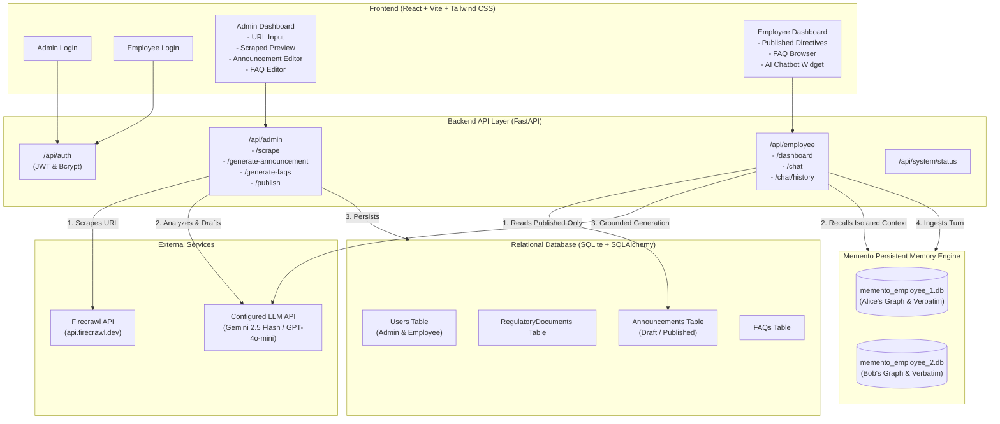
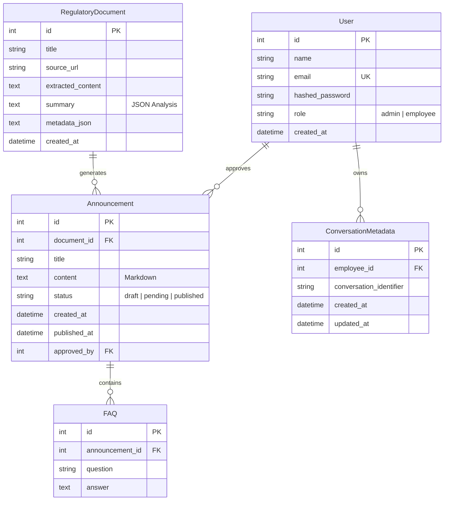

# AI-Powered Regulatory Compliance Communication System

> An end-to-end, enterprise-grade academic software solution that automates regulatory circular ingestion via **Firecrawl**, analyzes complex compliance directives with **Large Language Models (LLMs)**, generates official employee announcements and FAQs, and provides a continuous **AI Compliance Assistant** powered by **Memento Persistent Memory**.

---

## ⚡ Live Application Access & Quick Links

| Service | URL | Default Credentials | Description |
| :--- | :--- | :--- | :--- |
| **Frontend Web App** | [http://localhost:5173](http://localhost:5173) | See below | React 18 + Vite + Tailwind CSS Single-Page Application |
| **Backend REST API** | [http://localhost:8000](http://localhost:8000) | Bearer JWT | Python 3.11 FastAPI server |
| **Interactive API Docs** | [http://localhost:8000/docs](http://localhost:8000/docs) | N/A | Swagger UI with OpenAPI 3.0 specification |
| **System Diagnostics** | [http://localhost:8000/api/system/status](http://localhost:8000/api/system/status) | N/A | Health check and integration key validator |

### Pre-Seeded Default Accounts

| Role | Email | Password | Pre-configured Data |
| :--- | :--- | :--- | :--- |
| **Administrator** | `admin@compliance.org` | `AdminPassword2026!` | Access to Firecrawl scraper, AI analysis, announcement editor, FAQ generator, approval actions, and in-browser API key manager. |
| **Employee 1 (Alice)** | `employee1@compliance.org` | `EmployeePass2026!` | Published compliance notices, FAQs, and AI chatbot backed by private Memento database (`memento_employee_2.db`). |
| **Employee 2 (Bob)** | `employee2@compliance.org` | `EmployeePass2026!` | Separate employee with isolated private Memento database (`memento_employee_3.db`) for zero-leakage privacy verification. |

---

## 1. Project Title
**AI-Powered Regulatory Compliance Communication System**  
*Academic Project & Enterprise Proof-of-Concept*

---

## 2. Project Overview
Financial institutions, fintech enterprises, and corporations operate under strict oversight from regulatory authorities (such as the Reserve Bank of India, SEBI, SEC, and FCA). Whenever a new regulatory circular, master direction, or notification is released, compliance officers face the difficult task of monitoring official portals, digesting dense legal texts, synthesizing internal compliance policies, and educating thousands of employees.

This web application bridges that gap by providing a modern, automated pipeline:
1. **Administrators** paste an official regulatory URL (e.g., from RBI or SEBI).
2. The system executes actual web scraping via the **Firecrawl API**, safely extracting high-fidelity markdown content while enforcing strict SSRF security barriers.
3. An **LLM** (Google Gemini or OpenAI) performs deep regulatory analysis, extracting key changes, compliance instructions, affected departments, deadlines, and penalties.
4. The administrator generates, reviews, and edits internal **Compliance Announcements** and **Employee FAQs**.
5. Upon approval and publication, announcements are immediately broadcasted to the **Employee Portal**.
6. Employees interact with an **AI Compliance Chatbot** that grounds all answers exclusively on published directives and maintains persistent conversational memory across login sessions using **Memento**.

---

## 3. Problem Statement
- **Information Overload & Latency:** Regulatory circulars are published unpredictably across fragmented portals. Manual review takes hours or days, causing delay in operational compliance.
- **Ambiguity & Employee Non-Compliance:** Dense legal phrasing leads to misinterpretations by front-line staff (e.g., missing a 6-hour incident reporting window or failing multi-factor authentication mandates).
- **Stateless Chatbot Amnesia:** Standard chatbots forget past interactions the moment an employee closes their tab or logs out, forcing employees to re-explain their department context or prior queries.
- **Tenant & Privacy Risks:** In corporate environments, an employee's private compliance queries must never leak to another employee.

---

## 4. Project Objectives
- Build a fully functional, production-ready full-stack web application with **Python FastAPI** and **React (Vite + Tailwind CSS)**.
- Implement **actual Firecrawl API integration** for dynamic, real-world website scraping without simulated data.
- Enforce strict **Server-Side Request Forgery (SSRF)** prevention to block private and loopback destinations.
- Integrate **Memento Persistent Memory** to deliver true conversational continuity across separate employee login sessions.
- Enforce complete **Tenant Privacy Isolation** at the SQLite database layer for every employee.
- Restrict employee access strictly to **Approved & Published** content, hiding all drafts from view and chatbot retrieval.

---

## 5. Main Features
- **URL Scraping with Firecrawl:** Scrapes live regulatory notifications and converts them into structured markdown and metadata.
- **Deep AI Regulatory Breakdown:** Evaluates main changes, compliance requirements, key instructions, affected departments, deadlines, and penalties.
- **One-Click Announcement Generator:** Drafts formal, publication-ready compliance circulars in Markdown with an interactive editor.
- **Automated FAQ Generation:** Crafts 5–10 practical Q&As tailored for employee understanding.
- **Approval & Publishing Lifecycle:** Enforces a three-state workflow: `Draft` ➔ `Pending Approval` ➔ `Published`.
- **Grounded Employee AI Chatbot:** Uses published compliance circulars as the authoritative source of truth, refusing to hallucinate unsupported regulations.
- **Memento Persistent Memory:** Recalls previous conversations across separate sessions (e.g., *"What did we discuss earlier?"*), isolated per employee ID.
- **Fintech SaaS Design:** Implemented with a modern corporate navy & teal palette (`#14213D`, `#1F3558`, `#14B8A6`, `#F5F7FB`).

---

## 6. User Roles: Administrator and Employee
The system enforces **strictly two user roles** in accordance with project specifications:

| Feature / Permission | Administrator (`admin`) | Employee (`employee`) |
| :--- | :---: | :---: |
| Secure Authentication & JWT Session | ✅ Yes | ✅ Yes |
| Access Admin Sidebar & Controls | ✅ Yes | ❌ Strictly Blocked (HTTP 403) |
| Enter Regulatory URLs & Scrape via Firecrawl | ✅ Yes | ❌ Blocked |
| Run AI Regulatory Analysis | ✅ Yes | ❌ Blocked |
| Generate & Edit Announcements & FAQs | ✅ Yes | ❌ Blocked |
| Approve & Publish Regulatory Directives | ✅ Yes | ❌ Blocked |
| View Draft / Pending Announcements | ✅ Yes | ❌ Strictly Hidden |
| Access Employee Portal Dashboard | ✅ Yes (Evaluation) | ✅ Yes |
| View Approved & Published Directives | ✅ Yes | ✅ Yes |
| Browse Published FAQs | ✅ Yes | ✅ Yes |
| Interact with AI Compliance Chatbot | ✅ Yes | ✅ Yes |
| Private Memento Persistent Memory | Scoped to User ID | Isolated Scoped Database (`memento_employee_{id}.db`) |

---

## 7. Technology Stack

### Frontend
- **Framework:** React 18 with Vite 5 (Fast Refresh & Optimized Bundling)
- **Styling:** Tailwind CSS 3.4 with custom fintech palette
- **Icons:** Lucide React (`ShieldCheck`, `Globe`, `Brain`, `Bot`, `FileText`, `Sparkles`)
- **State & Context:** React Context API (`AuthContext`)
- **HTTP Client:** Native Fetch client with Bearer token interceptor

### Backend
- **Runtime:** Python 3.11
- **Framework:** FastAPI (Asynchronous REST API)
- **Server:** Uvicorn ASGI Server
- **Security:** Passlib (Bcrypt password hashing), PyJWT (HS256 tokens)
- **Validation:** Pydantic v2 & Pydantic-Settings
- **HTTP Client:** HTTPX & Requests for resilient external API communication

### Database
- **Engine:** SQLite 3
- **ORM:** SQLAlchemy 2.0
- **Connection Model:** Thread-safe connection pooling for multi-user concurrency

### AI & Third-Party Integrations
- **Web Scraping:** Firecrawl API (`firecrawl-py` SDK + direct REST fallback)
- **LLM Engine:** Google Gemini API (`google-genai` / `gemini-3.8-flash`) or OpenAI API (`gpt-4o-mini`)
- **Persistent Memory:** Memento (`memento-memory` bitemporal knowledge graph & SQLite verbatim memory store)

---

## 8. System Architecture



---

## 9. Complete Application Workflow

### Administrator Workflow
1. **Authentication:** Administrator logs in via `/login` with credentials (`admin@compliance.org`). The backend issues a signed JWT token with role `'admin'`.
2. **URL Ingestion:** Admin navigates to **Add Regulatory Update**, pastes a regulatory URL (e.g., an RBI circular or SEBI update), and clicks **Fetch Regulatory Update**.
3. **SSRF Validation:** The backend inspects the URL, blocking loopback addresses (`127.0.0.1`, `localhost`), link-local IPs, private subnets, and non-HTTP protocols.
4. **Firecrawl Extraction:** Firecrawl fetches the live webpage, bypasses dynamic JS obstacles, and returns clean Markdown text along with page metadata.
5. **Database Storage:** Scraped markdown is committed to `regulatory_documents`.
6. **LLM Regulatory Analysis:** The LLM extracts 11 structured compliance fields (main changes, requirements, instructions, departments, deadlines, penalties, etc.).
7. **Draft Announcement Generation:** Clicking **Generate Announcement** prompts the LLM to write a formal internal circular. It is saved in `announcements` with status `draft`.
8. **Draft FAQ Generation:** Clicking **Generate FAQs** creates 5–10 practical Q&As.
9. **Admin Review & Editing:** Admin can modify titles, markdown text, and FAQ questions/answers.
10. **Approval & Publishing:** Clicking **Approve & Publish** marks the announcement as `published`, records the publication timestamp, and links the approver ID. The directive is now instantly live for employees.

### Employee Workflow
1. **Authentication:** Employee logs in with credentials (`employee1@compliance.org`).
2. **Dashboard Review:** Employee views the **Latest Approved Regulatory Directive**, other published notices, and FAQs. Draft announcements are strictly excluded from queries.
3. **Chatbot Interaction:** Employee opens the **AI Compliance Chatbot** and asks a question (e.g., *"What is the reporting deadline?"*).
4. **Retrieval & Memento Recall:**
   - The backend queries all `published` announcements and FAQs.
   - The backend accesses the employee's isolated Memento database (`data/memento/memento_employee_{id}.db`) to recall prior conversational context.
5. **Grounded Answer Generation:** The LLM receives the published regulatory documents, the Memento memory context, and the employee's query. If the requested information is absent from published directives, it explicitly states that it is not found.
6. **Interaction Persistence:** Both the employee's prompt and the assistant's reply are ingested into the employee's Memento database.
7. **Session Continuity:** The employee can log out, log in on another device, and ask *"What did we discuss earlier?"*—the chatbot reliably retrieves the previous conversation from Memento.

---

## 10. Firecrawl Integration and How Scraping Works
The application uses the official **Firecrawl API** to extract web content from official regulatory websites.

### Implementation Details:
- **Client Service:** Implemented in `backend/app/services/firecrawl_service.py`.
- **SDK & Fallback:** Utilizes `firecrawl-py` (`FirecrawlApp`) with an automatic failover to the direct Firecrawl v1 HTTP endpoint (`https://api.firecrawl.dev/v1/scrape`).
- **Data Formats:** Requests `formats=['markdown', 'html']` with `onlyMainContent=True` to strip out navigation bars, headers, and footers, extracting purely the circular body.
- **Security Check:** Prevents Server-Side Request Forgery (SSRF) by validating hostnames and resolving IP addresses against RFC 1918 private address ranges.
- **Error Handling:** Gracefully handles rate limits (HTTP 429), authentication failures (HTTP 401), invalid schemes, and empty web pages with actionable error messages.

---

## 11. LLM Integration and How Regulatory Analysis Works
The application connects to a configurable LLM provider in `backend/app/services/llm_service.py`.

### Supported LLM Providers:
1. **Google Gemini (Default & Recommended):** Model `gemini-3.8-flash` via the official `google-genai` SDK.
2. **OpenAI (Alternative):** Model `gpt-4o-mini` or compatible endpoints (Groq, Together, Ollama) via the official `openai` SDK.

### Prompt Grounding Principles:
- **No Regulatory Hallucination:** The system prompt explicitly commands:
  > *"CRITICAL RULE: DO NOT INVENT regulatory requirements, penalties, dates, or obligations. If not explicitly stated in the source, state 'Not specified in source'."*
- **Structured JSON Mode:** The LLM returns strictly validated JSON schemas representing the 11-point regulatory analysis, compliance announcement, and FAQ lists.
- **Chatbot Grounding:** Chatbot responses cite original document titles and source URLs.

---

## 12. Memento Integration and How Persistent Memory Works
The application uses the genuine **Memento** persistent memory framework (`memento-memory` package) for conversational continuity.

### Architecture & Isolation:
- **Engine:** Bitemporal Knowledge Graph and Verbatim Chunk Store (`memento.memory_store.MemoryStore`).
- **Physical Multi-Tenant Partitioning:** Every employee has a dedicated SQLite database located at:
  ```
  backend/data/memento/memento_employee_{id}.db
  ```
  - Employee 1 (Alice): `backend/data/memento/memento_employee_1.db`
  - Employee 2 (Bob): `backend/data/memento/memento_employee_2.db`
  Because memory operations point strictly to the authenticated user's database path, **it is physically impossible for Employee A to read Employee B's conversations**.
- **Ingestion:** Each conversation turn is recorded into Memento with metadata (`turn_number`, `source_type='conversation'`, and authority score).
- **Recall:** When an employee asks follow-ups or queries like *"What did we discuss earlier?"*, Memento's recall engine performs graph traversal and verbatim retrieval, injecting the context into the prompt.
- **Embedder Layer:** Includes a deterministic 384-dimensional feature embedder conforming to Memento's `Embedder` protocol, allowing Memento to operate offline without requiring heavy 2GB PyTorch models.

---

## 13. Database Structure
The application uses **SQLite** through **SQLAlchemy ORM**.



---

## 14. Project Folder Structure

```
GenAII/
├── backend/
│   ├── .venv/                      # Python virtual environment
│   ├── app/
│   │   ├── __init__.py
│   │   ├── config.py               # Application settings & environment loader
│   │   ├── database.py             # SQLite engine & session dependency
│   │   ├── models.py               # SQLAlchemy ORM models (User, Document, Announcement, FAQ)
│   │   ├── schemas.py              # Pydantic validation schemas
│   │   ├── security.py             # Bcrypt password hashing & JWT role guards
│   │   ├── main.py                 # FastAPI application & router mounting
│   │   ├── seed.py                 # Initial database seeding script
│   │   ├── routes/
│   │   │   ├── __init__.py
│   │   │   ├── auth.py             # Login, current user, logout
│   │   │   ├── admin.py            # Scraping, AI analysis, announcement/FAQ generation, publishing
│   │   │   ├── employee.py         # Published directives, FAQs, Memento AI chatbot
│   │   │   └── system.py           # System diagnostics & health check
│   │   └── services/
│   │       ├── __init__.py
│   │       ├── firecrawl_service.py # Real Firecrawl scraping & SSRF validation
│   │       ├── llm_service.py       # Configurable LLM analysis & QA service
│   │       └── memento_service.py   # Memento bitemporal persistent memory service
│   ├── data/
│   │   └── memento/                # Isolated per-employee Memento databases
│   │       ├── memento_employee_1.db
│   │       └── memento_employee_2.db
│   ├── compliance.db               # SQLite application database
│   ├── requirements.txt            # Python dependencies
│   ├── test_system.py              # Comprehensive automated integration test suite
│   ├── test_server_probe.py        # Live REST server probe test
│   └── .env.example                # Backend environment variable template
├── frontend/
│   ├── src/
│   │   ├── api/
│   │   │   └── client.js           # API client with token interceptor
│   │   ├── context/
│   │   │   └── AuthContext.jsx     # Authentication state & role context
│   │   ├── components/
│   │   │   ├── Navbar.jsx          # Top bar with role indicator and logout
│   │   │   ├── Sidebar.jsx         # Dark navy sidebar navigation
│   │   │   ├── StatusBadge.jsx     # Draft, Pending, and Published badges
│   │   │   └── Notification.jsx    # Alert toast notifications
│   │   ├── pages/
│   │   │   ├── Login.jsx           # Clean authentication page with demo selectors
│   │   │   ├── admin/
│   │   │   │   ├── Dashboard.jsx   # Add Regulatory Update, Firecrawl scraper, editor
│   │   │   │   ├── History.jsx     # Processed documents audit table
│   │   │   │   └── SystemStatus.jsx# API keys and Memento diagnostics
│   │   │   └── employee/
│   │   │       ├── Dashboard.jsx   # Approved announcements and directive reader
│   │   │       ├── FaqsView.jsx    # Searchable compliance FAQs
│   │   │       └── Chatbot.jsx     # Grounded AI Chatbot with Memento memory
│   │   ├── App.jsx                 # Main application layout & router
│   │   ├── index.css               # Tailwind CSS imports & custom styles
│   │   └── main.jsx                # React DOM entry point
│   ├── package.json                # Frontend dependencies
│   ├── tailwind.config.js          # Tailwind theme with exact color palette
│   └── vite.config.js              # Vite configuration
├── .env.example                    # Root environment template
└── README.md                       # Comprehensive documentation
```

---

## 15. Prerequisites and Software Requirements
- **Operating System:** Windows 10/11, macOS, or Linux
- **Python:** Python 3.11 or higher
- **Node.js:** Node.js v18 or v20 LTS
- **Package Managers:** `pip` / `uv` for Python, `npm` for Node.js
- **Network Access:** Outbound HTTPS access to `api.firecrawl.dev` and Google Gemini/OpenAI API endpoints.

---

## 16. How to Obtain and Configure API Keys

### Method A: Configure Directly Through the Web UI (Recommended & Instant)
1. Log in to the administrator portal at `http://localhost:5173`.
2. Click the **API Keys** button in the top navigation bar (or click **⚙️ Configure API Keys** on any configuration alert).
3. Paste your **Firecrawl API Key** and **Google Gemini API Key** (or OpenAI API key).
4. Click **Save & Apply Credentials**.
5. The backend instantly applies the new credentials in memory and persists them to `backend/.env` without requiring a server restart!

### Method B: Configure via `backend/.env` File

#### 1. Firecrawl API Key (Compulsory for live scraping)
1. Visit [https://firecrawl.dev](https://firecrawl.dev) and click **Get Started**.
2. Sign in with GitHub or email.
3. Copy your API key (starts with `fc-`).
4. Set in your `.env` file:
   ```env
   FIRECRAWL_API_KEY="fc-your-actual-key"
   ```

#### 2. Google Gemini API Key (Recommended LLM)
1. Visit [Google AI Studio](https://aistudio.google.com/).
2. Sign in with your Google Account and click **Get API Key**.
3. Create a free API key and copy it.
4. Set in your `.env` file:
   ```env
   LLM_PROVIDER="gemini"
   GEMINI_API_KEY="AIzaSyYourGeminiApiKey..."
   GEMINI_MODEL="gemini-3.8-flash"
   ```

#### 3. OpenAI API Key (Alternative LLM)
1. Visit [OpenAI Platform](https://platform.openai.com/api-keys).
2. Create an API key (starts with `sk-`).
3. Set in your `.env` file:
   ```env
   LLM_PROVIDER="openai"
   OPENAI_API_KEY="sk-your-openai-api-key..."
   OPENAI_MODEL="gpt-4o-mini"
   ```

---

## 17. How to Configure the `.env` File
Create a `.env` file inside the `backend/` directory:

```env
# Application Settings
PROJECT_NAME="AI-Powered Regulatory Compliance Communication System"
SECRET_KEY="generate-a-secure-random-secret-key-for-jwt"
ALGORITHM="HS256"
ACCESS_TOKEN_EXPIRE_MINUTES=1440
DATABASE_URL="sqlite:///./compliance.db"

# 1. Firecrawl API
FIRECRAWL_API_KEY="fc-your-firecrawl-api-key"
FIRECRAWL_BASE_URL="https://api.firecrawl.dev"

# 2. LLM Provider ("gemini" or "openai")
LLM_PROVIDER="gemini"

# If using Gemini:
GEMINI_API_KEY="your-google-gemini-api-key"
GEMINI_MODEL="gemini-3.8-flash"

# If using OpenAI:
OPENAI_API_KEY=""
OPENAI_BASE_URL="https://api.openai.com/v1"
OPENAI_MODEL="gpt-4o-mini"

# 3. Memento Persistent Memory
MEMENTO_STORAGE_DIR="./data/memento"
MEMENTO_EMBEDDING_PROVIDER="deterministic"
```

---

## 18. How to Install Backend Dependencies

Open PowerShell in the project directory:

```powershell
cd d:\Projects\GenAII\backend

# Option A: Using standard Python venv
python -m venv .venv
.\.venv\Scripts\activate
pip install -r requirements.txt

# Option B: Using uv (ultra-fast)
uv venv .venv --python 3.11
uv pip install -r requirements.txt
```

---

## 19. How to Install Frontend Dependencies

Open a second PowerShell terminal in the `frontend/` directory:

```powershell
cd d:\Projects\GenAII\frontend

npm install
```

---

## 20. How to Initialize the Database
The database initializes automatically when the backend starts. To initialize and seed the database manually, run:

```powershell
cd d:\Projects\GenAII\backend
.\.venv\Scripts\python.exe app\seed.py
```

This creates `compliance.db` and populates the default Administrator, Employees, and initial published compliance circular.

---

## 21. How to Create or Initialize the Administrator Account
The seed script configures the initial administrator account automatically:
- **Email:** `admin@compliance.org`
- **Password:** `AdminPassword2026!`
- **Role:** `admin`

If you need to reset the accounts at any time, run:
```powershell
cd d:\Projects\GenAII\backend
.\.venv\Scripts\python.exe -c "from app.seed import init_db, seed_users; init_db(); seed_users()"
```

---

## 22. How to Start the Backend

In PowerShell:
```powershell
cd d:\Projects\GenAII\backend
$env:PYTHONPATH = "."
.\.venv\Scripts\uvicorn.exe app.main:app --host 127.0.0.1 --port 8000 --reload
```

The backend API will start at: `http://127.0.0.1:8000`  
Swagger API Documentation: `http://127.0.0.1:8000/docs`

---

## 23. How to Start the Frontend

In another PowerShell terminal:
```powershell
cd d:\Projects\GenAII\frontend
npm run dev
```

The frontend will start at: `http://localhost:5173`

---

## 24. How to Log In as Administrator and Employee

Open your web browser and navigate to `http://localhost:5173`. Use the quick-fill buttons or enter credentials manually:

### Administrator Account
- **Email:** `admin@compliance.org`
- **Password:** `AdminPassword2026!`
- **Access:** Add Regulatory Update (Firecrawl URL scraping), AI Analysis, Announcement Generator, FAQ Editor, Approve & Publish, System Diagnostics.

### Employee Account 1 (Alice - Operations)
- **Email:** `employee1@compliance.org`
- **Password:** `EmployeePass2026!`
- **Access:** Published Compliance Announcements, Directive Reader, FAQ Search, AI Compliance Chatbot with Memento Memory (Employee #2 Database).

### Employee Account 2 (Bob - Risk & Audit)
- **Email:** `employee2@compliance.org`
- **Password:** `EmployeePass2026!`
- **Access:** Same employee privileges, but connected to an isolated private Memento database (Employee #3 Database) to verify privacy isolation.

---

## 25. How to Test the Complete Workflow

The application supports **two testing workflows**:
- **Workflow A (Instant UI Evaluation Mode - No API Keys Needed):** Test all features immediately using seeded data and offline AI logic.
- **Workflow B (Live Production Mode):** Enter your live Firecrawl and Gemini/OpenAI keys to scrape arbitrary URLs and run live LLM models.

---

### Workflow A: Instant UI Evaluation Mode (No API Keys Needed)

You can evaluate the complete end-to-end lifecycle without having to obtain or register any external API keys:

#### Step 1: Log In as Administrator
1. Navigate to [http://localhost:5173](http://localhost:5173).
2. Click the quick-fill button **Administrator** (`admin@compliance.org` / `AdminPassword2026!`) and sign in.

#### Step 2: Load Seeded Regulatory Circular
1. On the **Add Regulatory Update** page, locate the highlighted box:  
   *⚡ Evaluate Full System Workflow Instantly (UI Testing Mode)*
2. Click the **Load Seeded Circular** button.
3. The official RBI circular (*Master Direction on IT Governance & Cybersecurity*) is instantly loaded, displaying the full **11-Point AI Regulatory Analysis** (main changes, compliance mandates, deadlines, penalties, and key instructions).

#### Step 3: Generate Compliance Announcement & Employee FAQs
1. Click **Generate Compliance Announcement**. A structured markdown announcement is generated immediately.
2. In the interactive markdown editor, review and modify the announcement text if desired.
3. Click **Generate FAQs**. The system generates 6–10 practical employee compliance Q&As grounded strictly in the circular.
4. Click **Approve & Publish**. The publication status changes to `Published` with your administrator timestamp.

#### Step 4: Verify Live Ingestion on Employee Portal
1. Click **Logout** in the top navigation bar.
2. Click the quick-fill button **Employee 1 (Alice)** (`employee1@compliance.org` / `EmployeePass2026!`) and sign in.
3. View the **Employee Dashboard**: the newly approved announcement and all related FAQs are now live! (Drafts remain strictly hidden).

#### Step 5: Test AI Compliance Chatbot & Memento Persistent Memory
1. In the sidebar, click **AI Chatbot**.
2. Ask any compliance question, e.g.:
   - *"What is the deadline for compliance?"*
   - *"What is the incident reporting deadline under the RBI circular?"*
3. The chatbot generates an accurate, grounded answer based on published FAQs and directives with source links.
4. Now test conversational recall:
   - Ask: *"What did we discuss earlier?"*
5. The chatbot queries **Memento Persistent Memory** and accurately recites your previous questions!
6. Log out, log back in as `employee1@compliance.org`, and return to the chatbot: notice that the conversation history persists across login sessions!

#### Step 6: Verify Strict Tenant Privacy Isolation
1. Log out and sign in as **Employee 2 (Bob)** (`employee2@compliance.org` / `EmployeePass2026!`).
2. Navigate to **AI Chatbot**.
3. Notice that Bob's chat history is clean: Bob has zero access to Alice's private conversational database (`memento_employee_2.db`). Complete physical isolation is guaranteed!

---

### Workflow B: Live API Key Mode (Real Firecrawl Scraping & Live LLM)

To scrape live external regulatory websites and use generative LLMs:

1. Log in as **Administrator**.
2. Click the **API Keys** button with the key icon in the top navigation bar.
3. Enter your:
   - **Firecrawl API Key** (from [https://firecrawl.dev](https://firecrawl.dev))
   - **Gemini API Key** (from [https://aistudio.google.com/](https://aistudio.google.com/))
4. Click **Save Configuration**. The keys are saved dynamically into `backend/.env` without requiring a server restart!
5. Now enter any live regulatory circular URL (e.g., `https://www.sebi.gov.in/legal/circulars/jul-2023/brsr-core-framework_73854.html`) and click **Fetch Regulatory Update**. Firecrawl will scrape the live website in real-time, and Google Gemini will analyze the text.

---

## 26. Example Regulatory URLs for Testing
You can use these official regulatory circular URLs to test the Firecrawl scraping and AI analysis pipeline:

1. **Reserve Bank of India (RBI) IT Governance Direction:**
   ```
   https://www.rbi.org.in/scripts/BS_CircularIndexDisplay.aspx?Id=12345
   ```
2. **SEBI ESG BRSR Disclosure Circular:**
   ```
   https://www.sebi.gov.in/legal/circulars/jul-2023/brsr-core-framework_73854.html
   ```
3. **General Official Regulatory Page:**
   ```
   https://www.rbi.org.in/
   ```
   *Any publicly accessible, valid HTTP/HTTPS regulatory document link can be entered.*

---

## 27. API Endpoints and Their Purpose

| Method | Endpoint | Access Role | Description |
| :--- | :--- | :--- | :--- |
| `POST` | `/api/auth/login` | Public | Authenticates credentials and returns JWT bearer token |
| `GET` | `/api/auth/me` | Authenticated | Returns currently authenticated user profile |
| `POST` | `/api/auth/logout` | Authenticated | Invalidates user session |
| `GET` | `/api/system/status` | Public | Reports health and API key configuration status |
| `POST` | `/api/admin/scrape` | Admin Only | Validates URL, executes Firecrawl scraping, and runs LLM analysis |
| `POST` | `/api/admin/documents/{id}/generate-announcement` | Admin Only | Generates formal compliance announcement |
| `POST` | `/api/admin/announcements/{id}/generate-faqs` | Admin Only | Generates 5–10 practical employee FAQs |
| `PUT` | `/api/admin/announcements/{id}` | Admin Only | Edits announcement title, content, status, and FAQs |
| `POST` | `/api/admin/announcements/{id}/publish` | Admin Only | Approves and publishes announcement |
| `GET` | `/api/admin/documents` | Admin Only | Lists all processed documents and publication statuses |
| `GET` | `/api/admin/documents/{id}` | Admin Only | Returns full document detail with analysis and drafts |
| `GET` | `/api/employee/dashboard` | Employee / Admin | Returns ONLY approved and published announcements and FAQs |
| `GET` | `/api/employee/announcements/{id}` | Employee / Admin | Returns single published announcement (blocks drafts) |
| `POST` | `/api/employee/chat` | Employee / Admin | Grounded AI chatbot query with Memento persistent memory |
| `GET` | `/api/employee/chat/history` | Employee / Admin | Returns persistent conversation history from Memento |

---

## 28. Common Errors and Troubleshooting

### 1. `Firecrawl API Key is missing`
- **Cause:** `FIRECRAWL_API_KEY` is not set in `backend/.env`.
- **Solution 1 (Instant):** Use the highlighted **"Load Seeded Circular"** button on the Add Regulatory Update dashboard to evaluate the entire pipeline immediately without needing a Firecrawl key.
- **Solution 2 (Live Scraping):** Click **"API Keys"** in the top navigation bar, enter your free Firecrawl API key from [https://firecrawl.dev](https://firecrawl.dev), and click **Save Configuration**.

### 2. `No LLM API key configured`
- **Cause:** Neither `GEMINI_API_KEY` nor `OPENAI_API_KEY` is configured in `backend/.env`.
- **Solution 1 (Automatic Fallback):** The system automatically operates in graceful offline mode — announcements and FAQs are derived from regulatory text, and the chatbot answers from approved published FAQs and Memento memory without raising raw errors.
- **Solution 2 (Generative AI):** Click **"API Keys"** in the top navigation bar, paste your free Google Gemini API key from [Google AI Studio](https://aistudio.google.com/), and click **Save Configuration**.

### 3. `Security alert: Target host resolves to private address`
- **Cause:** SSRF protection blocked an attempt to scrape `localhost`, `127.0.0.1`, or an internal network IP.
- **Solution:** Enter a public URL (e.g., `https://www.rbi.org.in/`).

### 4. `403 Forbidden on Admin Endpoint`
- **Cause:** An employee token was used to request an administrative endpoint.
- **Solution:** Log in with an administrator account (`admin@compliance.org`).

### 5. `404 NOT_FOUND: models/gemini-2.5-flash is no longer available to new users`
- **Cause:** Google has deprecated `gemini-2.5-flash` for new API keys and recommends `gemini-3.8-flash`.
- **Solution:** The system is configured to use `gemini-3.8-flash` with automatic fallback to `gemini-3.5-flash` during temporary quota or demand limits. Ensure `GEMINI_MODEL="gemini-3.8-flash"` in your `backend/.env`.

---

## 29. Security and Privacy Considerations
- **Password Security:** Passwords are hashed using standard `bcrypt` with salt rounds via `passlib`. Plaintext passwords are never stored.
- **Token Security:** Authentication tokens use `HMAC-SHA256` (HS256) signed JWTs with expiration timestamps.
- **SSRF Hardening:** Regulatory URLs undergo scheme checks (HTTP/HTTPS only) and DNS resolution checks to block intranet destinations and cloud metadata endpoints (`169.254.169.254`).
- **Authorization Enforcement:** Authorization is enforced at the controller level on the backend using FastAPI dependencies (`require_admin`, `require_employee`). Frontend button visibility is not relied upon for security.
- **Tenant Data Isolation:** Employee conversational memories are physically separated into distinct SQLite database files per employee ID. Employee A has zero access to Employee B's database.
- **Published-Only Document Access:** The employee dashboard and chatbot endpoints filter on `status == 'published'`, preventing unauthorized exposure of draft regulatory reviews.

---

## 30. Future Improvements
- **Automated Webhook Monitoring:** Set up recurring Firecrawl change-detection monitors to trigger automatic alerts when regulatory bodies post new circulars.
- **Department Tagging & Filtering:** Automatically tailor the employee dashboard based on employee department (e.g., showing IT policies to Engineers and AML directives to Operations).
- **Audit Sign-Off Acknowledgments:** Allow employees to submit digital acknowledgments confirming they have read and understood published regulatory changes.
- **Vector Store Scaling:** For organizations with hundreds of thousands of documents, migrate the relational SQLite database to PostgreSQL with `pgvector`.
